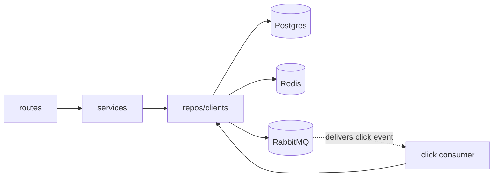
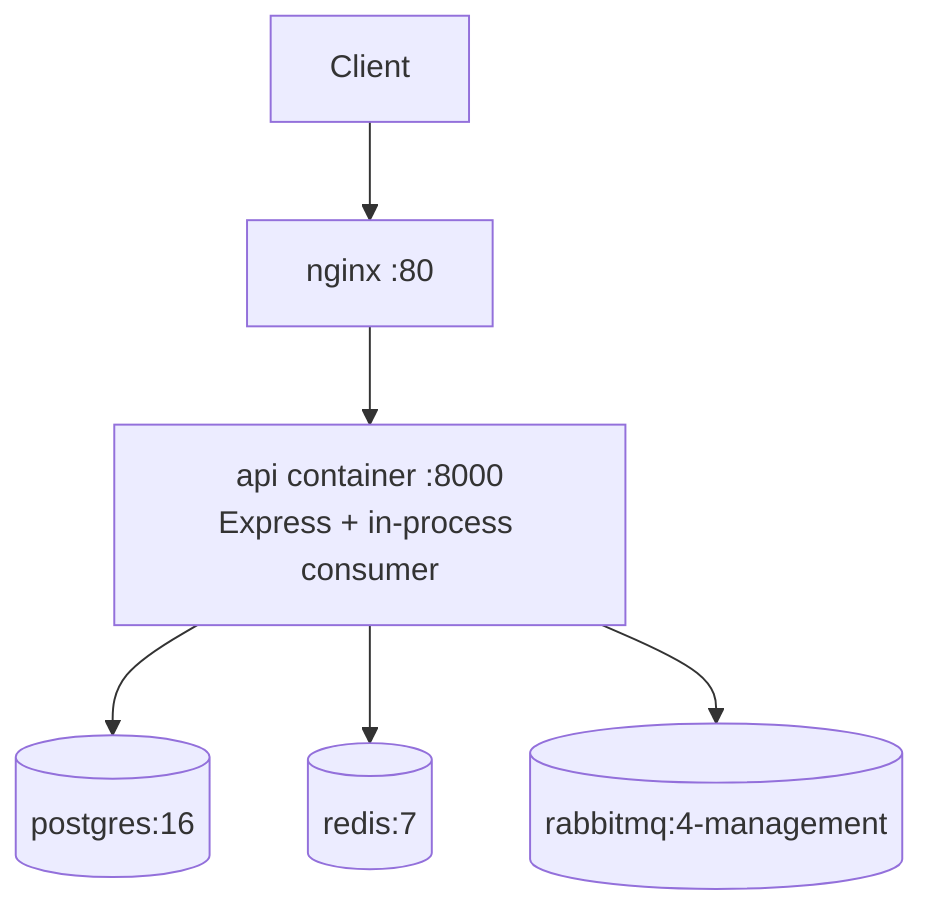
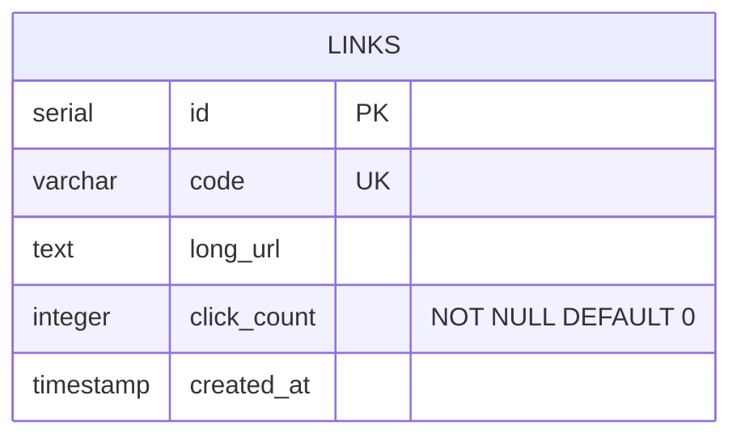

# Architecture Spine — URL Shortener MVP

## Design Paradigm

**Layered**: routes → services → repos/clients, one-way dependency.

| Layer | Directory | Owns |
| --- | --- | --- |
| Routes | `src/routes/` | HTTP req/res, input validation, status codes — no infra calls |
| Services | `src/services/` | Business logic: shorten, resolve-with-cache-aside, publish-click, consume-click |
| Repos/Clients | `src/repos/` | Postgres repo, Redis client wrapper, RabbitMQ publisher/consumer client — no business logic |

Chosen over hexagonal ports/adapters: three real infra dependencies (pg, redis, amqplib) don't yet earn interface indirection (Rule of Three).

## Invariants & Rules



### AD-1 — Layered paradigm, one-way dependency

- **Binds:** all FRs
- **Prevents:** infra concerns (pg/redis/amqplib) leaking into route handlers; services reaching back up into the HTTP layer
- **Rule:** services never import Express `req`/`res`; repos/clients never call services; routes never call repos/clients directly

### AD-2 — In-process click consumer

- **Binds:** FR6, FR7
- **Prevents:** a separate worker topology emerging ad hoc, beyond what's scaffolded
- **Rule:** the RabbitMQ consumer starts in the same process as the Express server (`src/index.js` boots both). No new `docker-compose.yml` service; the existing `api` service hosts both.

### AD-3 — Click count is a single counter column, not an event log

- **Binds:** FR7, FR9, FR10
- **Prevents:** a builder introducing a separate click-events table for analytics this MVP doesn't need
- **Rule:** `links.click_count` is an integer column, incremented in place by the consumer. No click-event history is persisted.

### AD-4 — Redirect never writes the click count, and never blocks on the publish

- **Binds:** FR6, FR7, NFR1
- **Prevents:** click-count logic leaking into the redirect path "just for now," defeating the async-decoupling pattern this project exists to practice; and a RabbitMQ outage turning every redirect into a 500
- **Rule:** only the consumer module may call the repo method that increments `click_count`. The redirect service/route must never call it, synchronously or otherwise. A failure to publish the click event is caught and logged; the redirect still responds successfully — click tracking never blocks or fails the redirect (same accepted-loss posture as FR8).

### AD-5 — Single shared Postgres pool

- **Binds:** FR1, FR2, FR4, FR7, FR9
- **Prevents:** connection-per-repo divergence or pool exhaustion
- **Rule:** one `pg.Pool` instance, created once (`src/repos/db.js`) and imported by every repo. No repo or service creates its own `Pool` or `Client`.

### AD-6 — Click-count increments are a single atomic statement

- **Binds:** FR7
- **Prevents:** a read-then-write implementation racing under concurrent redirects and silently losing increments
- **Rule:** the increment is one SQL statement — `UPDATE links SET click_count = click_count + 1 WHERE code = $1`. Application code never reads `click_count` before writing it back.

### AD-7 — Schema bootstrap, no migration framework

- **Binds:** FR1–FR10 (the `links` table itself)
- **Prevents:** two builders disagreeing on whether a migration tool is expected, or the table simply not existing when `docker compose up` runs
- **Rule:** the repo layer runs `CREATE TABLE IF NOT EXISTS links (...)` once at boot (`src/repos/db.js`, on pool initialization). No separate migration tool/framework for this MVP.

### AD-8 — Infra clients never connect at module-import time

- **Binds:** NFR3
- **Prevents:** a repo/client module that opens a live Postgres/Redis/RabbitMQ connection as a side effect of being `require`d, which would silently break the existing convention that `require('./app')` alone (as the test suite does) never touches live services
- **Rule:** `pg.Pool`, the Redis client, and the amqplib connection are constructed but not connected/opened at module load. Connection happens only when `src/index.js` boots the server, or lazily on first real use — never as an import side effect.

## Consistency Conventions

| Concern | Convention |
| --- | --- |
| Naming (entities, files, interfaces, events) | Short code is the public identifier everywhere (routes, responses, logs); Postgres `id` (serial PK) stays internal, never returned by any endpoint |
| Data & formats (ids, dates, error shapes, envelopes) | Redis key: `shorturl:{code}` → long URL. RabbitMQ: durable queue `click-events` (asserted `{ durable: true }`), messages published `{ persistent: true }`, body `{ code: string, timestamp: <ISO 8601 string> }`. Redirect: HTTP 302 (Found). Success responses: shorten → `{ "shortUrl": "<url>", "code": "<code>" }`; count → `{ "code": "<code>", "clicks": <n> }`. Errors: `{ "error": "<message>" }` JSON — 400 on invalid URL (shorten), 404 on unknown code (redirect, count) |
| State & cross-cutting (mutation, errors, logging, config, auth) | Click-count mutation is consumer-only (AD-4). Config via existing `.env` vars only (`DATABASE_URL`, `REDIS_URL`, `RABBITMQ_URL`, `BASE_URL`, `PORT`) — no new vars. Logging via `pino`, no other library. No auth, no rate limiting (NFR4) |

## Stack

| Name | Version |
| --- | --- |
| Node.js | 20 (`node:20-alpine`, pinned in `Dockerfile`) |
| Express | ^5.2.1 |
| pg | ^8.23.0 |
| redis (node-redis) | ^6.2.1 |
| amqplib | ^2.0.1 |
| pino | ^10.3.1 |
| Jest | ^30.5.1 |
| Supertest | ^7.2.2 |
| Postgres (image) | 16 |
| Redis (image) | 7 |
| RabbitMQ (image) | 4-management (bumped from 3-management — community support for 3.x ended 2025-07-31; `docker-compose.yml` needs this tag updated at build time) |

## Structural Seed





```text
src/
  index.js         # boots Express server + RabbitMQ consumer (AD-2)
  app.js            # Express app, route mounting
  routes/
    links.js         # POST /shorten, GET /:code (redirect), GET /:code/clicks
  services/
    shortenService.js    # generates code, persists mapping
    redirectService.js   # cache-aside resolve (AD reads Redis first, falls back to Postgres)
    clickPublisher.js    # publishes click event after successful redirect
    clickConsumer.js     # consumes click-events queue, increments click_count (AD-4)
    statsService.js      # thin pass-through for click-count query (keeps FR9/FR10 on routes -> services -> repos, per AD-1)
  repos/
    db.js             # shared pg Pool (AD-5); runs CREATE TABLE IF NOT EXISTS on init (AD-7); no connection opened at import time (AD-8)
    linksRepo.js       # Postgres access for links table; atomic click_count increment (AD-6)
    cache.js           # Redis client wrapper; lazy-connects (AD-8)
    queue.js           # RabbitMQ connection, publisher + consumer channel; lazy-connects (AD-8)
  logger.js          # pino instance
  __tests__/
```

### API Endpoints

| Method & path | Request | Success response | Errors |
| --- | --- | --- | --- |
| `POST /shorten` | `{ "url": "https://example.com/very/long/path" }` | `201` `{ "shortUrl": "http://short.local/aZ3kT9x", "code": "aZ3kT9x" }` | `400` `{ "error": "url must be a valid http(s) URL" }` on a missing/invalid/non-http(s) `url` |
| `GET /:code` | path param `code` | `302` with `Location: <long_url>`, empty body | `404` `{ "error": "short code not found" }` on unknown `code` |
| `GET /:code/clicks` | path param `code` | `200` `{ "code": "aZ3kT9x", "clicks": 42 }` | `404` `{ "error": "short code not found" }` on unknown `code` |

- `code` is base62 (`[A-Za-z0-9]`), ~7 characters, matching the addendum's short-code assumption — routes reject a malformed `code` param (regex mismatch) with the same `404` shape rather than a `400`, since an invalid code and an unknown code are indistinguishable to the caller and both mean "this link doesn't resolve."
- `shortUrl` is composed from `BASE_URL` + `code` (existing `.env` var) — never hardcoded.
- `GET /:code` and `GET /:code/clicks` sit at root, not nested under `/shorten`, so the redirect stays a bare, shareable link (`short.local/aZ3kT9x`) rather than `short.local/shorten/aZ3kT9x`.
- No endpoint accepts a custom `code` or an `alias` field — enforces FR1/FR2 (auto-generated only) at the contract level, not just as an implementation habit.

## Capability → Architecture Map

| Capability / Area | Lives in | Governed by |
| --- | --- | --- |
| Shorten (FR1, FR2) | `routes/links.js` → `services/shortenService.js` → `repos/linksRepo.js` | AD-1 |
| Redirect + cache-aside (FR3, FR4, FR5) | `routes/links.js` → `services/redirectService.js` → `repos/cache.js`, `repos/linksRepo.js` | AD-1, AD-4 |
| Click publish (FR6) | `services/redirectService.js` → `services/clickPublisher.js` → `repos/queue.js` | AD-4 |
| Click consume (FR7, FR8) | `services/clickConsumer.js` → `repos/linksRepo.js` | AD-2, AD-3, AD-4, AD-6 |
| Click count query (FR9, FR10) | `routes/links.js` → `services/statsService.js` → `repos/linksRepo.js` | AD-1, AD-3 |
| Schema bootstrap | `repos/db.js` | AD-7, AD-8 |

## Deferred

- **Short-code collision handling** — explicitly out of scope (PRD Out of Scope); no uniqueness retry/backoff decided.
- **Retry/DLQ for the consumer** — explicitly out of scope (FR8); a message lost on consumer failure is accepted, not handled.
- **Auth, rate limiting, link expiration** — explicitly out of scope (NFR4, PRD Out of Scope).
- **Redis eviction/TTL policy** — no expiry set; deferred until cache growth is an actual concern (no update/delete path makes entries stale today).
- **RabbitMQ connection resiliency** (reconnect on drop) — not addressed; acceptable gap at this hobby scope, would need revisiting before any real deployment.
- **Consumer concurrency/scaling** — single consumer instance assumed; no prefetch/concurrency tuning decided.
- **Redis 7 image licensing** (RSALv2/SSPLv1 since 7.4, not OSI open source) — accepted for this non-redistributed, internal exercise; would need revisiting if this ever shipped as a product.
- **Postgres 16 vs. current major (18)** — 16 is supported through 2028; no currency concern at this scope, not bumped.
- **Supertest 7 + Express 5 pairing** — no formally confirmed compatibility statement found, but the existing `health.test.js` already exercises this pairing successfully — treated as empirically ratified, not re-litigated.
